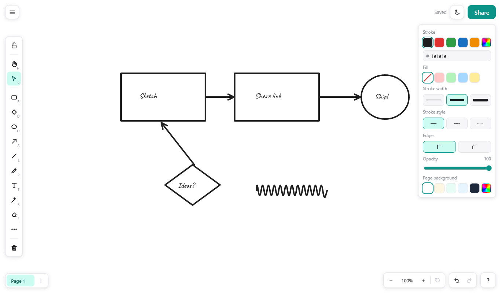
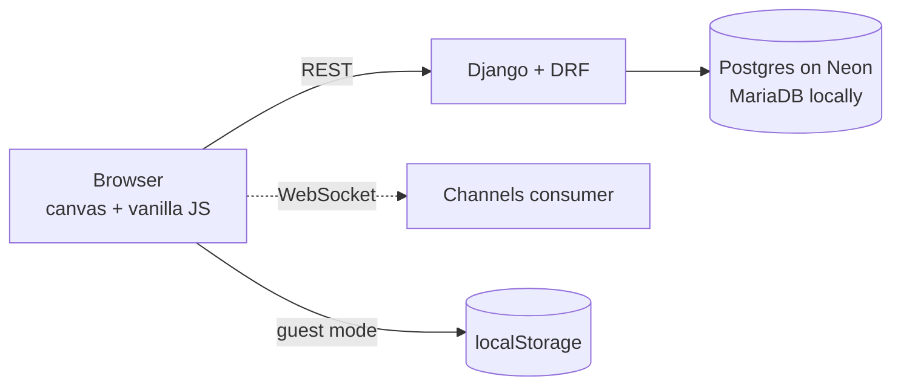

<h1 align="center">Sketch<span>Saathi</span></h1>

<p align="center">
  <em>Saathi</em> (साथी) means <em>companion</em> in Hindi. SketchSaathi is a whiteboard that keeps you company
  while you think: sketch an idea, drop in a few notes, send a link, and plan it together.
</p>

<p align="center">
  <a href="https://sketchsaathi.in"><strong>sketchsaathi.in</strong></a> &nbsp;·&nbsp;
  <a href="docs/setup.md">Run it locally</a> &nbsp;·&nbsp;
  <a href="docs/deploy-vercel.md">Deploy your own</a>
</p>

<p align="center">
  <a href="LICENSE"></a>
  
  
  
</p>

<p align="center">
  <a href="https://sketchsaathi.in">
    <picture>
      <source media="(prefers-color-scheme: dark)" srcset="docs/images/editor-dark.png">
      
    </picture>
  </a>
</p>

---

## Try it in a minute

1. Open [sketchsaathi.in](https://sketchsaathi.in) and press **Start drawing**. No sign-up and nothing to install.
2. Pick a tool on the left (or press <kbd>R</kbd>, <kbd>A</kbd>, <kbd>T</kbd>) and start drawing.
3. Press **Share** and send the link. Anyone with it can open the board.
4. Sign up whenever you like. The sketches you made as a guest move into your account.

## What it does

**Draw**
Pen, line, arrow, rectangle, diamond, ellipse, text and an eraser, in a hand-written style.
Hold <kbd>Shift</kbd> for straight lines, squares and circles. Add images by pasting or dropping them,
group things in frames, highlight with the laser pointer, fill with the bucket, and select with a lasso.

**Edit**
Click, shift-click or drag a box to select. Move, resize, flip, lock, duplicate, copy and paste, reorder layers,
and undo or redo anything, including deletes and clears.

**Organise**
A board is a notebook: it holds as many pages as you want, each with its own background colour.
Boards are saved to your account as you draw, and the browser warns you if you try to leave with unsaved changes.

**Share and keep**
Boards have private, random links. Collaborators see each other's cursors live where WebSockets are available.
You can also save a board as a `.saathi` file, open it again later, or export a page as PNG.

**Comfortable**
Light and dark themes, a mobile layout with pinch-to-zoom, a collapsible style panel, and an optional grid.

### Keyboard shortcuts

| Key | Action | Key | Action |
|---|---|---|---|
| <kbd>V</kbd> / <kbd>H</kbd> | Select / hand | <kbd>R</kbd> <kbd>D</kbd> <kbd>O</kbd> | Rectangle, diamond, ellipse |
| <kbd>A</kbd> / <kbd>L</kbd> | Arrow / line | <kbd>P</kbd> / <kbd>T</kbd> | Pen / text |
| <kbd>E</kbd> / <kbd>K</kbd> | Eraser / laser | <kbd>Ctrl</kbd>+<kbd>A</kbd> | Select all |
| <kbd>Ctrl</kbd>+<kbd>Z</kbd> / <kbd>Y</kbd> | Undo / redo | <kbd>Ctrl</kbd>+<kbd>S</kbd> / <kbd>O</kbd> | Save / open file |
| <kbd>Ctrl</kbd>+<kbd>'</kbd> | Toggle grid | <kbd>?</kbd> | Show every shortcut |

## How it is built



- **Frontend:** a hand-written canvas engine (no drawing library) with its own undo history, and Bootstrap 5 for the landing, login and signup pages.
- **Backend:** Django 6.1 with plain function views, a small REST API for boards and pages, and Channels for live cursors.
- **Data:** MariaDB / MySQL on your machine, Postgres on Neon in production.
- **Hosting:** Vercel. Live collaboration needs a Redis channel layer there, so it is switched off on the hosted site.

## Run it on your computer

```bash
git clone https://github.com/perwez-akhtar/sketchsaathi.git
cd sketchsaathi
python -m venv venv
venv\Scripts\activate            # macOS / Linux: source venv/bin/activate
pip install -r requirements-dev.txt
```

Create a MySQL / MariaDB database named `sketchsaathi` (or set `DATABASE_URL` to any Postgres URL), then:

```bash
python manage.py migrate
python manage.py runserver
```

Open <http://127.0.0.1:8000>. Settings come from environment variables or a private `.env` file.
See [`.env.example`](.env.example) and the full [setup guide](docs/setup.md).

## Tests

```bash
python manage.py test                                                         # unit, API, security, realtime
set RUN_BROWSER_TESTS=1 && python manage.py test boards.tests.test_browser    # real-browser tests (Edge + Playwright)
```

The suite covers the API, ownership rules, SQL-injection attempts, login lockout, file import and export,
and the editor itself (drawing, selection, undo, autosave, mobile touch).

## Safety

- Board links are random UUIDs, and only the owner can rename or delete a board or page.
- Drawing data is checked on the server for type, size and count before it is stored.
- Sign-up needs a real email address: known throwaway-mail domains are refused.
- Logins are rate-limited per address, pages are served with `no-store`, and production runs with
  debug off, HTTPS only and secure cookies.

Found a hole? Please [open an issue](https://github.com/perwez-akhtar/sketchsaathi/issues).

## Project layout

```
config/            settings, URLs, ASGI and WSGI
boards/
  views.py         landing, editor, login and signup pages
  api/             REST API for boards and pages
  realtime/        WebSocket consumer for live collaboration
  templates/       site and editor templates
  static/          CSS and JavaScript (canvas, app, collab, ...)
  tests/
docs/              setup and deployment guides, screenshots
```

## Contributing

Bug reports, ideas and pull requests are welcome. Fork the repo, make your change,
run the tests above, and open a pull request.

## License

[MIT](LICENSE) © 2026 Md Perwez Akhtar
